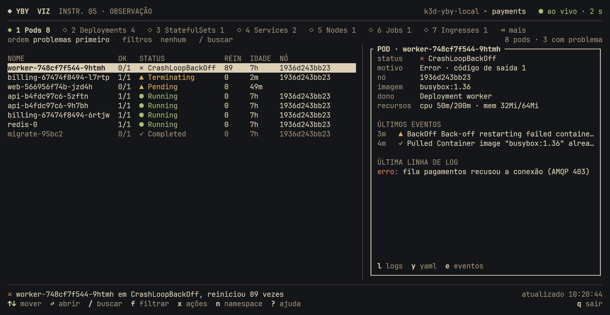
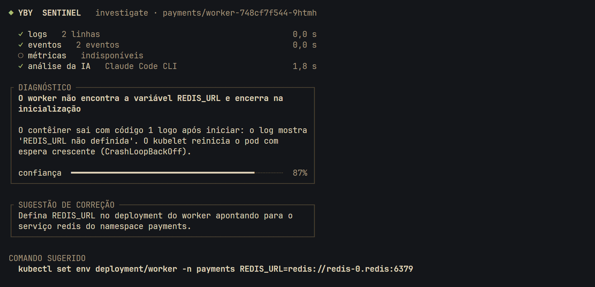
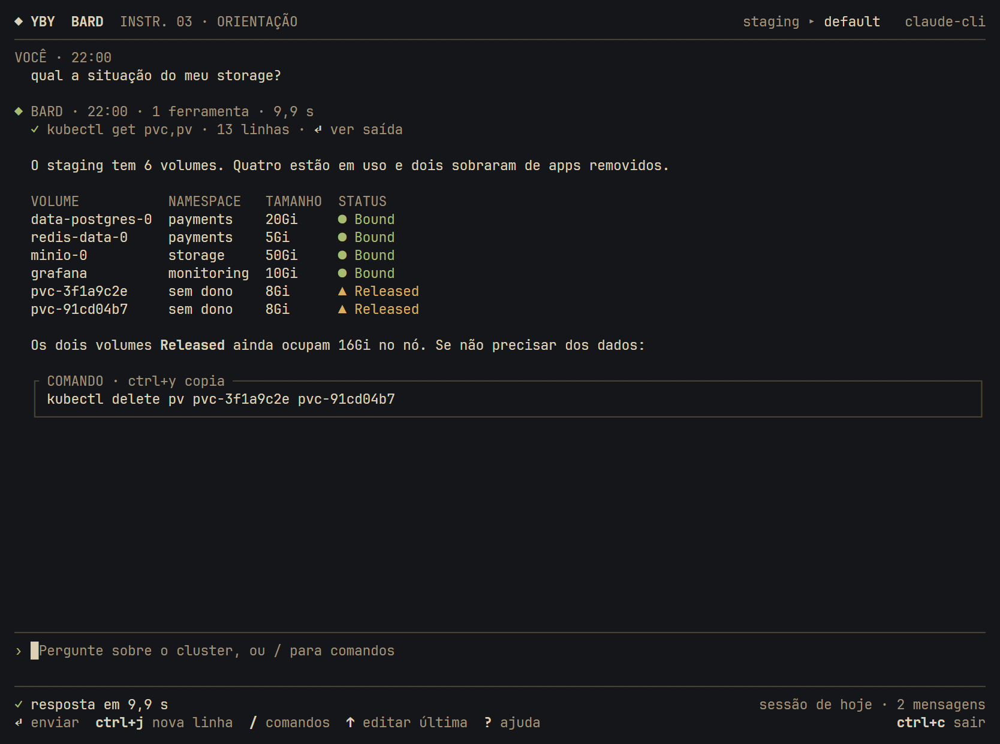
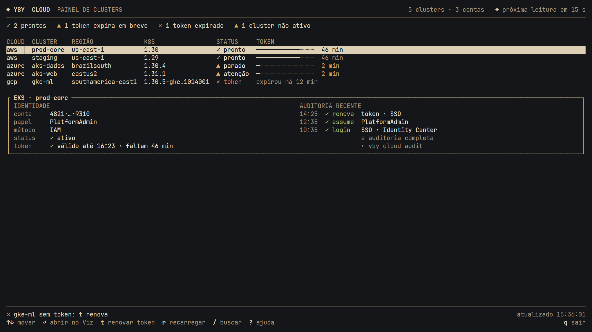

# 🤖 Yby CLI - Infrastructure Intelligence Assistant

<div align="center">

<picture>
  <source media="(prefers-color-scheme: dark)" srcset="docs/assets/brand/yby-logo-white.svg">
  
</picture>

### [🌐 Website Oficial](https://yby.dev.br)

</div>

> **Yby (Tupi: Terra)** - O solo fértil para suas aplicações. A **Plataforma de Engenharia** que atua como seu assistente inteligente para bootstrap, governança e operação de clusters Kubernetes.

---

## 🧠 O Que é o Yby?

O **Yby CLI** não é apenas um wrapper de comandos. Ele é um **Assistente Estratégico** que orbita o ciclo de vida da sua infraestrutura, fornecendo:

1.  🚀 **Bootstrap Platform**: Entrega um cluster de produção "batteries-included" em minutos (VPS -> K3s -> ArgoCD -> Monitoring).
2.  ☁️ **Multi-Cloud** (beta): Conecta e gerencia clusters em AWS EKS, Azure AKS e GCP GKE com refresh automático de credenciais.
3.  🛡️ **Guardian (Governança)**: Garante padrões de arquitetura e segurança desde o Day 0.
4.  🤖 **Intelligence Layer**: Usa IA (Ollama, Claude, Gemini, OpenAI, Bedrock) para diagnosticar problemas (`sentinel`), documentar arquitetura (`atlas`) e gerir conhecimento (`synapstor`).
5.  💻 **Developer Experience**: Abstrai a complexidade do ambiente local sem esconder a realidade do Kubernetes.

---

## 🆚 Yby vs Kubectl

O Yby **não substitui** o `kubectl`. Eles trabalham juntos:

| Funcionalidade | Ferramenta Padrão | Abordagem Yby |
| :--- | :--- | :--- |
| **Interagir com Cluster** | `kubectl get pods` | `yby sentinel investigate` (Adiciona IA e Contexto ao diagnóstico) |
| **Gerenciar Releases** | `helm install` | `yby chart create` (Gera Boilerplate Padronizado e Seguro) |
| **Setup Inicial** | Scripts Bash manuais | `yby bootstrap vps` (Declarativo, Idempotente e Seguro) |
| **Documentação** | Wiki desatualizada | `yby synapstor` (Conhecimento vivo extraído do código) |

> **Resumo:** Use o `kubectl` para operar. Use o `yby` para entender, planejar e evoluir.

---

## 🚀 Instalação

Cada [release](https://github.com/casheiro/yby-cli/releases) traz o yby para Linux, macOS e Windows, em amd64 e arm64, com o `checksums.txt` (SHA-256 de cada arquivo).

### Linux e macOS

```bash
curl -fsSL https://raw.githubusercontent.com/casheiro/yby-cli/main/install.sh | sh
```

O script escolhe o pacote do sistema e da arquitetura (no Mac com Apple Silicon, o arm64), baixa a última versão, confere o SHA-256 e instala em `/usr/local/bin`, com `sudo` se a pasta não for sua. Para outra versão ou outra pasta:

```bash
curl -fsSL https://raw.githubusercontent.com/casheiro/yby-cli/main/install.sh | YBY_VERSION=v5.8.3 YBY_INSTALL_DIR="$HOME/.local/bin" sh
```

### Windows

No PowerShell (o Windows PowerShell 5.1 ou o PowerShell 7), sem administrador:

```powershell
irm https://raw.githubusercontent.com/casheiro/yby-cli/main/install.ps1 | iex
```

O script baixa o zip da última versão, confere o SHA-256, instala o `yby.exe` em `%LOCALAPPDATA%\Programs\yby` e põe essa pasta no PATH do usuário. Abra um terminal novo depois: os que já estavam abertos não veem o PATH novo. Para outra versão, outra pasta ou sem mexer no PATH (`-SemPath`):

```powershell
& ([scriptblock]::Create((irm https://raw.githubusercontent.com/casheiro/yby-cli/main/install.ps1))) -Versao v5.8.3 -Destino C:\ferramentas\yby
```

**À mão:** baixe `yby_<versão>_windows_amd64.zip` (ou `_arm64.zip`) da página de [releases](https://github.com/casheiro/yby-cli/releases), extraia o `yby.exe` numa pasta sua (por exemplo `%LOCALAPPDATA%\Programs\yby`) e ponha a pasta no PATH: no menu Iniciar, procure "Editar as variáveis de ambiente para sua conta", abra `Path`, clique em **Novo**, cole a pasta e confirme. Depois, abra um terminal novo.

> **Instalou pelo `go install` com o caminho antigo?** Sem o `/v5`, ele instalava a v1.12.2, de 2025, em `%USERPROFILE%\go\bin\yby.exe` (no Linux e no macOS, `~/go/bin/yby`). Essa pasta costuma vir antes no PATH: apague esse arquivo, ou reinstale pelo caminho novo abaixo. O `install.sh` e o `install.ps1` avisam quando outro yby vem antes do recém-instalado.

### Com o Go

```bash
go install github.com/casheiro/yby-cli/v5/cmd/yby@latest
```

Precisa do Go 1.26 ou mais novo e instala em `$(go env GOPATH)/bin` (`~/go/bin`; no Windows, `%USERPROFILE%\go\bin`), que precisa estar no PATH. O `/v5` no caminho é obrigatório: sem ele, o Go ignora as tags da v2 em diante. Vale para as versões depois da v5.8.3. O `go install` traz só o core; os plugins nativos se instalam depois pelo próprio yby (veja abaixo).

### Variante `yby-cloud`

Cada release traz também `yby-cloud_<versão>_<sistema>_<arquitetura>.tar.gz` (`.zip` no Windows), com os SDKs da AWS, da Azure e do GCP embutidos: o token do EKS, do AKS e do GKE sai sem os CLIs `aws`, `az` e `gcloud`, e o provider de IA Amazon Bedrock fica disponível. O executável se chama `yby-cloud` (`yby-cloud.exe`); instale à mão, como no Windows acima. O `install.sh` e o `install.ps1` instalam só a variante padrão. Depois de instalado, o `yby-cloud upgrade` baixa o pacote `yby-cloud_…`.

### Plugins

O Viz, o Bard, o Sentinel, o Synapstor e o Atlas são executáveis à parte, instalados pelo yby em `~/.yby/plugins`, na mesma versão do core:

```bash
yby plugin install viz      # ou bard, sentinel, synapstor, atlas
yby plugin list             # o que está instalado
yby plugin update           # depois de um yby upgrade, põe os nativos na versão nova do core
```

Plugins de terceiros e a criação do seu estão no [guia de plugins](docs/wiki/Plugins.md).

### Conferir, atualizar e desinstalar

```bash
yby version        # versão instalada
yby doctor         # ferramentas que o yby usa (Docker, kubectl, Helm…) e credenciais cloud
yby upgrade        # troca o executável pela última release, conferindo o SHA-256 (--check só verifica)
yby uninstall      # remove o executável; o ~/.yby (configuração e dados) fica
```

No Windows, o `yby uninstall` tira o `yby.exe` do lugar na hora e o arquivo some do disco quando o yby fecha.

Até a v5.8.3, o `yby upgrade` procura um pacote que não existe e para em "asset não encontrado": saia dessas versões reinstalando pelo script ou pelo pacote da release, como acima. No Windows, o `yby plugin install` dessas versões também falha com os nativos ("unsupported archive format"); extraia o `yby-plugin-<nome>_<versão>_windows_amd64.zip` da release em `%USERPROFILE%\.yby\plugins` e rode `yby plugin trust <nome>`.

---

## 🛠️ Exemplo de Uso

### 1. Bootstrap (Day 0)
Crie um novo projeto GitOps pronto para produção:
```bash
yby init        # Cria a estrutura do projeto
yby bootstrap   # Provisiona o cluster (Local ou VPS)
```

### 2. Operação Assistida (Day 1+)
Acompanhe o cluster ao vivo no Viz, com os problemas primeiro:
```bash
yby viz
```



Seu pod falhou? Pergunte ao Sentinel:
```bash
yby sentinel investigate worker-748cf7f544-9htmh -n payments
```



Ou converse com o Bard, que roda as ferramentas por você (no Viz, `b` abre o Bard já com a pergunta sobre o recurso selecionado):
```bash
yby bard
```



> **Modo visual:** o tema segue o terminal. Force com `YBY_THEME=dark` ou `YBY_THEME=light`, use `YBY_ASCII=1` em terminais sem Unicode e `NO_COLOR=1` para tirar as cores (ou `ui.theme` e `ui.ascii` no `~/.yby/config.yaml`).

### 3. Multi-Cloud (EKS / AKS / GKE) · beta
> **Beta:** testado com os CLIs `aws`, `az` e `gcloud` e conferido contra a documentação oficial, mas ainda não contra clusters reais. O que falta validar está no [ROADMAP](./ROADMAP.md). Relate problemas nas [issues](https://github.com/casheiro/yby-cli/issues).

Conecte clusters de qualquer cloud pública com auth avançada:
```bash
# Conectar a cluster cloud (interativo)
yby cloud connect

# Conectar a cluster EKS (não-interativo)
yby cloud connect --provider aws --region us-east-1 --cluster meu-cluster --env-name prod

# Listar clusters disponíveis
yby cloud list

# Verificar status de credenciais
yby cloud status

# Refresh de token
yby cloud refresh

# Dashboard multi-cluster interativo
yby cloud dashboard

# Auditoria de operações cloud
yby cloud audit --since 24h --export json
```



**Auth avançada:** SSO/MFA (AWS), device code/interactive/certificado/MSI (Azure), Workload Identity Federation/SA impersonation/Connect Gateway (GCP). Credential store seguro via OS keychain com fallback encriptado. Audit log JSONL para compliance.

> **Build cloud:** Para binário com SDKs nativos (AWS/Azure/GCP), use `task build:cloud`. O binário padrão (`task build`) usa fallback via CLIs instalados.

### 4. Evolução (Day N)
Precisa de um novo serviço?
```bash
yby chart create meu-novo-app  # Cria chart seguindo Golden Path da empresa
yby up                         # Sobe ambiente de dev local espelhando produção
```

---

## 🧩 Extensibilidade (Plugins)

O Yby foi desenhado para ser estendido. Não encontrou o que precisa? Crie seu próprio comando!

*   **Linguagem Agnóstica**: Seu plugin pode ser em Go, Rust, Bash, Python... qualquer coisa que fale JSON.
*   **API Simples**: Receba contexto no `STDIN`, devolva ações no `STDOUT`.
*   **Distribuição Fácil**: Publique no GitHub e instale com `yby plugin install`.

[📖 Guia de Desenvolvimento de Plugins](docs/wiki/Plugins.md)

---

## 🏢 Enterprise Ready

O Yby entrega defaults opinativos para PMEs, mas adapta-se a qualquer ambiente enterprise via um arquivo de overrides:

```yaml
# .yby/overrides.yaml
registry:
  url: 012345678.dkr.ecr.sa-east-1.amazonaws.com
  pullSecret: regcred
ingress:
  className: nginx
namespaces:
  prefix: "fintech"
tls:
  issuer: custom
  caSecretName: corp-ca
```

```bash
yby init --config .yby/overrides.yaml
```

Customiza: registry privado, ingress class, TLS/CA corporativa, storage class, namespaces com prefixo, labels de compliance, versoes de charts, resource profiles e mais. [Guia completo](docs/wiki/Enterprise-Overrides.md).

---

## 📚 Documentação

A documentação completa está na nossa **Wiki**:

- **[Getting Started](docs/wiki/Getting-Started.md)**: Passos iniciais.
- **[Core Concepts](docs/wiki/Core-Concepts.md)**: Estrutura, Monorepo e Arquivos Gerados.
- **[Architecture](docs/wiki/Architecture.md)**: Diagramas, Componentes e Segurança.
- **[Enterprise Overrides](docs/wiki/Enterprise-Overrides.md)**: Customizacao para ambientes corporativos.
- **[Governance](docs/wiki/Governance.md)**: IA, Agentes e DevGovOps.
- **[Plugins](docs/wiki/Plugins.md)**: Bard, Viz, Sentinel, Synapstor e Atlas, com as teclas de cada TUI.
- **[Operations](docs/wiki/Operations.md)**: Operação do dia a dia, clusters cloud e solução de problemas.
- **[CLI Reference](docs/wiki/CLI-Reference.md)**: Todos os comandos e flags.
- **[CHANGELOG](CHANGELOG.md)**: Teclas e comportamentos que mudaram entre versões.

---

## 📂 Estrutura Gerada

```text
.
├── .github/workflows/    # Pipelines CI/CD e Release Automation
├── .yby/                 # Definições do Blueprint e Ambientes
├── infra/                # Manifestos Kubernetes (Helm/Kustomize)
│   ├── charts/           # Charts locais (Golden paths)
│   └── manifests/        # ArgoCD Apps (GitOps state)
└── README.md
```

---

<div align="center">
  <sub>Construído com 💚 pela Casheiro Org</sub>
</div>
